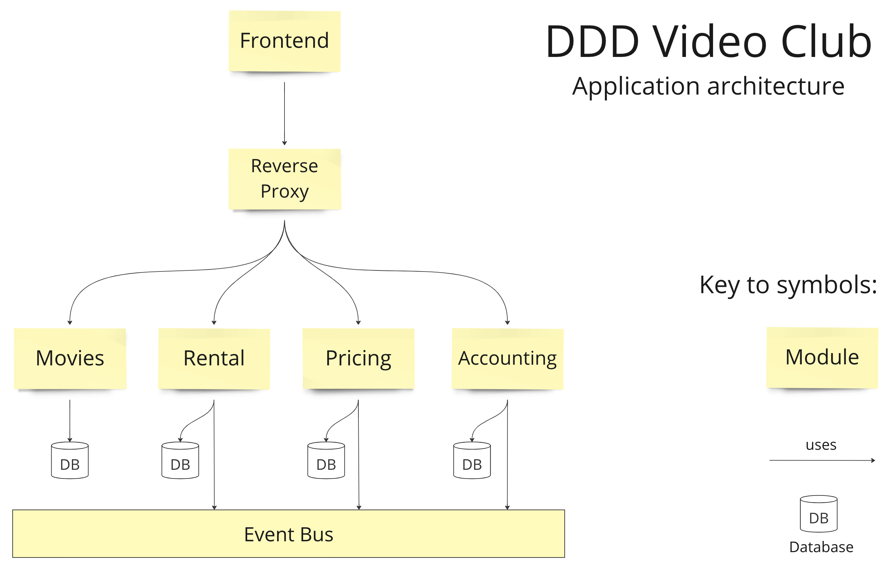

# ddd-video-club


Sample for [Matthias Bohlen](https://mbohlen.de)'s
[Domain-Driven Design class](https://mbohlen.de/domain-driven-design-cpsa-a/)
(iSAQB Advanced Level).

It is a small application to rent movies for a few days, watch them inside a
browser, and be billed for this.

Kind of "poor man's Netflix".

It demonstrates how to design such a thing using DDD, and how to implement it in TypeScript
on NodeJS, using the principles of the "ports and adapters" architectural style, as described by
Alistair Cockburn.

## What the Application Does

This is a sample application developed for Matthias Bohlen's Domain-Driven Design (DDD) Advanced Level course (iSAQB Certified). It implements a simplified video rental system where users can:

- Browse and select from available movies
- Rent movies for a specified number of days
- Watch rented movies directly in the browser
- View their account billing information

The application demonstrates DDD principles and the "ports and adapters" (hexagonal) architectural style using TypeScript on Node.js.

Key features include:

- Movie catalog with categories (e.g., Science Fiction, Romance)
- Rental management with duration tracking
- Pricing calculations with support for discount campaigns
- Account billing and overview
- Event-driven architecture for inter-service communication

## How It's Structured

The project is organized as a monorepo using bun workspaces, with packages divided into conceptual modules (business domains) and technological modules (infrastructure):

Conceptual Modules (Business Logic)

- Movies: Manages movie catalog and metadata
- Rental: Handles movie rental transactions and publishes domain events
- Pricing: Calculates rental prices and applies discount campaigns
- Accounting: Tracks customer accounts and billing

Technological Modules (Infrastructure)

- Database: PostgreSQL via Bun's built-in SQL client, with plain SQL migrations
- Event Bus: RabbitMQ for asynchronous inter-service communication
- Reverse Proxy: Caddy server that routes each URL to the service owning it, and serves the static files
- Web UI: shared page layout, CSS, images, [htmx](https://htmx.org) and the [Cally](https://wicky.nillia.ms/cally) calendar for the server-rendered pages

Architecture Pattern

Each conceptual module follows DDD layered architecture with ports and adapters:

- Domain Model: Pure TypeScript types/entities (e.g., Movie, Rental)
- Application Service: Business logic orchestration (e.g., MovieAppService, RentalAppService)
- Repository Interface: Data access abstraction

Adapters:

- HTTP: [Hono](https://hono.dev) JSON APIs (`/api/...`) and HTML pages rendered on the server with Hono JSX
- Persistence: Database implementations using plain SQL (Bun SQL)

Services communicate via domain events published to the event bus (e.g., MOVIE_RENTED event triggers pricing and accounting updates).


## Packages in the `packages` directory

The app consists of the following conceptual modules:

- Movies (using NodeJS)
- Rental (using NodeJS)
- Pricing (using NodeJS)
- Accounting (using NodeJS)

Additionally, there are 3 technological modules:

- Database (using PostgreSQL)
- Event Bus (using RabbitMQ)
- Reverse Proxy (using Caddy Server)

There is no separate frontend. Each service renders the HTML pages of its own bounded context with Hono JSX
(movies: `/movie-selection` and `/movie/:id/viewing`, rental: the rent dialog under `/rentals`,
accounting: `/account`). The browser gets plain HTML pages with a little help from htmx 4, and popups
are native `<dialog>` elements. The shared layout, CSS and images live in `packages/web-ui`.



## How to build

Install Node and [bun](https://bun.sh). Then go to the root folder of this project and type

```
bun install
bun run build
```

This compiles all TypeScript packages (with TypeScript 7) and bundles every service.

## How to run

### Using Docker (Recommended for full stack)

Every service is bundled by `bun build` into a single `dist/main.js`, which the stock `oven/bun` image runs directly (mounted as a volume). There are no custom Docker images to build. Caddy serves the static files (CSS, htmx, images) from `packages/web-ui/public`.

The project uses a single `docker-compose.yml` to orchestrate the entire stack, including PostgreSQL, RabbitMQ, the four services (movies, rental, pricing, accounting), and Caddy reverse proxy.

1. Build the bundles (see "How to build"), then start the full stack:
   ```
   cd deployment
   docker compose up -d
   ```
2. The database migrations are applied automatically by the one-shot `migrate` service before the backend services start. To re-run them manually: `docker compose run --rm migrate`.

3. Access the application at http://localhost:5001.

4. View logs: `docker compose logs -f [service]`

5. Stop: `docker compose down`

### Local Development (Without Docker)

For local development without Docker:

#### Start the database and initialize the schema

```
cd packages/database
docker-compose up -d
sleep 30
bun run migrate:up
```

#### Start the event bus

```
cd packages/event-bus
docker-compose up -d
```

#### Start the API servers

1. `cd packages/movies && bun run dev` (port 4000)

2. `cd packages/rental && bun run dev` (port 4001)

3. `cd packages/pricing && bun run dev` (no HTTP port)

4. `cd packages/accounting && bun run dev` (port 4002)

#### Start the reverse proxy

Install Caddy: `brew install caddy` (macOS).

```
cd packages/reverse-proxy
caddy run
```

(port 5001)

Then open http://localhost:5001.

### Demo Usage

Browse movies at http://localhost:5001, rent one (e.g., Matrix for 5 days), view account at /account. To test discounts, insert into discount_campaigns table via psql.

## Run Integration Test in Pricing

```
cd packages/pricing
bun run test
```

(q to quit)

